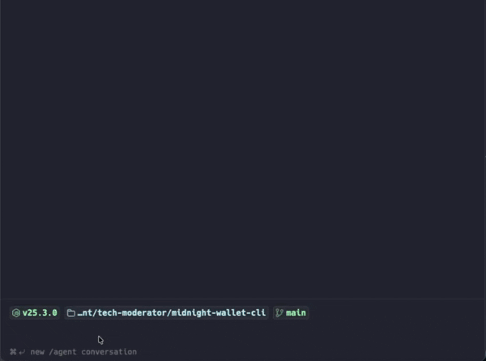

# midnight-wallet-cli



[](https://www.npmjs.com/package/midnight-wallet-cli)
[](https://npm-stat.com/charts.html?package=midnight-wallet-cli)
[](https://www.apache.org/licenses/LICENSE-2.0)
[](https://www.typescriptlang.org/)


A standalone CLI wallet for the Midnight blockchain. Manage wallets, check balances, transfer NIGHT tokens, and manage a local network — all from the terminal.

Built for two audiences: **beginners** starting their first Midnight project (a local chain + funded wallets + contract deploy in minutes), and **AI agents** (Cursor, Claude Code, any MCP client) using the same primitives via a built-in MCP server.

> [!IMPORTANT]
> **0.6.0 (prerelease, `npm install -g midnight-wallet-cli@next`) is ledger-9 only.** It is built on wallet-sdk 2.0.0, ledger-v9 1.0.0, midnight-js 5.0.0 and compact-runtime 0.21.0 (contracts compiled with Compact 0.36 / language 0.28). It refuses any chain still on ledger 8 up front (`UNSUPPORTED_LEDGER`): stay on 0.5.x (`npm install -g midnight-wallet-cli@latest`) for such a chain. `preview` and `mainnet` run ledger 9.
>
> `midnight localnet up` starts a ledger-9 stack (node 2.1.0-rc.4, indexer 4.4.0-rc.6, proof server 9.0.0). To use another ledger-9 stack instead: on the default ports (node 9944, indexer 8088, proof server 6300) `--network undeployed` reaches it with no configuration. On other ports pass `--node`, `--indexer-ws` and `--proof-server` per command, or save them once with `midnight config set node <url>`, `midnight config set indexer-ws <url>` and `midnight config set proof-server <url>`.

## Install

```bash
npm install -g midnight-wallet-cli        # stable 0.5.x (ledger 8)
npm install -g midnight-wallet-cli@next   # this ledger-9 prerelease
```

This installs two commands: `midnight` (or `mn` for short) and `midnight-wallet-mcp`.

Install the prerelease with npm 11 or older (or run it with `npx`; with npm 12, `npx -y npm@11 install -g midnight-wallet-cli@next`). The engine ships an `npm-shrinkwrap.json` that pins the SDK set it was tested with; npm 12 and bun's installer ignore it and resolve the packages again, so the engine either installed is refused before any SDK loads, saying so (`MIXED_SDK_LAYOUT`). bun can run what npm installed.

## Commands

<!-- commands: generated by npm run readme-commands -->
| Command | Description |
|---------|-------------|
| `midnight wallet <generate\|list\|use\|info\|remove\|seed\|protect> [args]` | Manage named wallets (generate, list, use, info, remove, seed, protect) |
| `midnight generate [--network <name>] [--seed <hex>] [--mnemonic "..."] [--output <file>] [--force]` | (Deprecated — use "midnight wallet generate <name>" instead) |
| `midnight info [--wallet <name\|file>]` | Display wallet address, network, creation date (no secrets shown) |
| `midnight balance [address] [--wallet <name\|file> \| --seed <hex>] [--shielded] [--force-shielded] [--network <name>] [--no-cache] [--node <url>] [--indexer-ws <url>] [--proof-server <url>] [--verbose]` | Check a wallet's unshielded + shielded balance, or an address's unshielded balance |
| `midnight address (--seed <hex> \| --wallet <name>) [--network <name>] [--index <n>]` | Derive and display an unshielded address from a seed or a saved wallet (one of --seed, MN_SEED or --wallet is needed) |
| `midnight genesis-address [--network <name>]` | Display the genesis wallet address (seed 0x01) for a network |
| `midnight inspect-cost [--network <name>] [--node <url>] [--indexer-ws <url>] [--proof-server <url>]` | Display the chain's current block limits, from its latest block's ledger parameters |
| `midnight airdrop <amount> [--shielded] [--wallet <name\|file\|address>] [--network <name>] [--node <url>] [--indexer-ws <url>] [--proof-server <url>] [--verbose]` | Fund a wallet from the genesis wallet (undeployed network only) |
| `midnight transfer <to> <amount> [--shielded [--force-shielded]] [--wallet <name\|file>] [--network <name>] [--proof-server <url>] [--node <url>] [--indexer-ws <url>] [--verbose]` | Send NIGHT tokens to another address (unshielded or --shielded) |
| `midnight dust <register\|status\|export> [--wallet <name\|file>] [--seed <hex> (export only)] [--proof-server <url>] [--node <url>] [--indexer-ws <url>] [--no-cache (status only)]` | Register UTXOs for dust (fee token) generation, check status, or export a restorable snapshot |
| `midnight config get [key] [--network <name>] \| midnight config <set\|unset> <key> [value] [--network <name>]` | Manage persistent config (default network, endpoints, etc.) |
| `midnight cache clear [--network <name>] [--wallet <name\|file>]` | Manage wallet state cache (clear cached sync data) |
| `midnight serve [--port <n>] [--wallet <name\|file>] [--network <name>] [--proof-server <url>] [--node <url>] [--indexer-ws <url>] [--approve-all \| --approve-fees [--max-fee <DUST>] [--max-pending <n>]] [--allow-origin <origin>]... [--force-shielded] [--no-auto-approve-reads] [--verbose] [--json]` | Start DApp Connector server over WebSocket JSON-RPC |
| `midnight test <create\|run\|list\|results> [options]` | Generate and run E2E test suites for Midnight dApps |
| `midnight dev [path]` | Iteration loop for Compact contract development (localnet + compile-on-save + one-key deploy) |
| `midnight contract <inspect\|deploy\|call\|state> [options]` | Inspect, deploy, call, and query Midnight smart contracts |
| `midnight swap <make\|inspect\|take\|cancel\|list> [options]` | Private swaps of shielded tokens, through offer files (experimental) |
| `midnight tx status <hash or identifier> [options]` | What became of a transaction: its block, time, fee and result |
| `midnight grant <deploy\|deposit\|status\|list\|issue\|revoke\|revoke-all\|export\|import\|device> [options]` | This wallet's account, and the grants that let an agent spend from it (experimental) |
| `midnight localnet <up\|stop\|down\|status\|logs\|clean> [--tail <n>]` | Manage a local Midnight network via Docker Compose |
| `midnight help [command]` | Show usage for all commands or a specific command |
| `midnight manual [--no-pager] [--raw] [--json]` | Full reference manual (long form, paged through $PAGER) |
<!-- commands: end -->

## Quick Start

### Local development (undeployed)

```bash
# 1. Start the local network (a ledger-9 node, indexer and proof server)
midnight localnet up

# 2. Create a wallet and set the network
midnight wallet generate alice
midnight config set network undeployed

# 3. Fund your wallet and register dust (needed for fees)
midnight airdrop 1000
midnight dust register

# 4. Check balance and transfer
midnight balance
midnight transfer mn_addr_undeployed1... 100
```

### Preprod / Preview (testnet)

Preview runs ledger 9. This build refuses a chain still on ledger 8 (use 0.5.x there), so preprod works with it once it runs ledger 9. The flow:

```bash
# 1. Create a wallet and set the network
midnight wallet generate alice
midnight config set network preprod   # or: preview

# Preprod only: its indexer and node are served by Blockfrost, which needs
# your own project id. Create a "Midnight Preprod" project at https://blockfrost.io
# and set its id once (it starts with nightpreprod):
midnight config set blockfrost-project-id <project id>

# 2. Get test tokens from the faucet
#    preprod: https://faucet.preprod.midnight.network/
#    preview: https://faucet.preview.midnight.network/
#    Paste your address from: midnight wallet info alice

# 3. Register dust (needed for fees)
midnight dust register

# 4. Check balance and transfer
midnight balance
midnight transfer mn_addr_preprod1... 100
```

## Supported Networks

| Network | Description |
|---------|-------------|
| `undeployed` | Local network (`midnight localnet up` starts it) |
| `preprod` | Midnight pre-production testnet (refused by this build while it is on ledger 8; use 0.5.x there). Its indexer and node are served by Blockfrost: needs a project id |
| `preview` | Midnight preview testnet (ledger 9) |
| `mainnet` | Midnight Mainnet (ledger 9). Reached only through Blockfrost, with a mainnet project id (it starts with `nightmainnet`); the proof server is your local one. No faucet. Real value: it must be named on every command with `--network mainnet` (it can't be the saved network), and `airdrop`, `mn test` and `mn grant` are refused there with `MAINNET_REFUSED`. Its addresses have no network segment: `mn_addr1…`, `mn_shield-addr1…` |

Wallets are network-agnostic — one seed derives addresses for all four networks. Use `--network <name>` on any command, or persist a test network with `midnight config set network preview` (mainnet is never persisted).

### Mainnet

mn reaches mainnet only when a command names it: `--network mainnet` on the command line, or the network parameter of an MCP tool. `midnight config set network mainnet` is refused, a saved config never resolves to mainnet, and a mainnet address (`mn_addr1…`) given to `midnight balance` without `--network mainnet` is refused instead of being read on mainnet.

Its indexer and node are served only by Blockfrost (Midnight's own `indexer.mainnet.midnight.network` and `rpc.mainnet.midnight.network` were retired on 2026-10-09). Create a project for Midnight Mainnet at [blockfrost.io](https://blockfrost.io) and set its id; mn keeps it beside a preprod id, each for its own network:

```bash
midnight config set blockfrost-project-id nightmainnet...   # filed under mainnet by its prefix
midnight balance --network mainnet
```

There is no faucet: fund a mainnet wallet by transferring NIGHT to it. `airdrop`, `mn test` (it deploys throwaway contracts) and `mn grant` (the account contract has no released key set for mainnet yet) are refused there before anything runs, with `MAINNET_REFUSED`. `mn dev` works on the local network only.

### Preprod and Blockfrost

Midnight shut its own preprod indexer down on 2026-10-09; [Blockfrost serves it now](https://docs.midnight.network/guides/networks-and-environments), along with the node RPC, and every request needs your own project id. Create a project for Midnight Preprod at [blockfrost.io](https://blockfrost.io) and give mn its id:

```bash
midnight config set blockfrost-project-id <project id>   # or: export BLOCKFROST_PROJECT_ID=<project id>  (MN_BLOCKFROST_PROJECT_ID wins if both are set)
```

- Project ids are per network: a preprod id starts with `nightpreprod`, a mainnet id with `nightmainnet`. mn files each under its own network and never sends one to the other network.
- Without one, a command that reaches preprod stops with `BLOCKFROST_PROJECT_ID_REQUIRED` and these instructions. A refused id is `BLOCKFROST_PROJECT_ID_REJECTED`. Requests count against your Blockfrost plan. (While preprod is on ledger 8, this ledger-9 build then refuses it with `UNSUPPORTED_LEDGER`.)
- The project id is a secret. mn keeps it in `~/.midnight/config.json` (mode 0600), shows it masked in `config get`, and hides it in everything it prints, errors and `--verbose` logs included.
- `mn serve` gives a connected dApp the wallet's indexer and node URLs (the DApp connector's `getConfiguration`), and on preprod those carry your project id: connect only dApps you trust with it.
- An old `indexer-ws` setting that points at `indexer.preprod.midnight.network` fails with `ENDPOINT_SHUT_DOWN`: remove it with `midnight config unset indexer-ws --network preprod`.
- Preview and the local network need no project id.

## Native dust acceleration

The first dust sync for a wallet on a hosted network replays the chain's full dust event history, the slow part of a cold start. A native (Rust) reader does this faster than the WASM one, installed as a per-platform `optionalDependency` (`@kuiralabs/dust-sync-<os>-<arch>`, built on the ledger-9 crates). On mainnet (1.6M Dust events through Blockfrost) a cold read takes about 11 minutes with it and about 18 without; most of the 11 minutes is streaming the events, since the ledger-8 history before the fork is read but not folded (the fork's migration starts ledger 9 from an empty Dust state).

mn runs the native reader only when it reports ledger 9 (`dust-sync --ledger`) and the chain tip is past the fork; otherwise, or if it fails, the WASM reader does the sync. Set `MN_DISABLE_NATIVE_DUST=1` to always use WASM, or `MN_DUST_SYNC_BIN` to run a binary of your own.

## DApp Connector

`midnight serve` starts a WebSocket JSON-RPC server that implements the same `ConnectedAPI` interface as the Lace browser wallet. Any DApp can connect to it — no browser extension needed.

```bash
# Start the connector server
midnight serve

# Or auto-approve all requests (dev only)
midnight serve --approve-all

# Or act as a fee wallet for an agent (see below)
midnight serve --approve-fees

# Let a dApp's page in a browser connect (its origin: scheme, host and port)
midnight serve --allow-origin http://localhost:5173
```

A web page can open a WebSocket to `localhost` as easily as your dApp can, so `mn serve` refuses every connection from a browser page (one that carries an `Origin` header) unless its origin is allowed with `--allow-origin <origin>`; repeat the flag for more pages. Node scripts send no `Origin` and always connect. A refused page gets HTTP 403, and `mn serve` prints the origin it refused. Allowing an origin with `--approve-all` prints a warning: any script that page runs can then spend from the wallet and have it sign without asking, so allow only pages you control. `mn test run` allows the page of the dApp under test (`url`, or `http://localhost:<port>` from `dapp.test.json`) on the serve it starts, and reuses a running serve only if that serve allows it.

Read methods never prompt. Every write prompts in the terminal (and is rejected without one), balancing included: `balanceUnsealedTransaction` / `balanceSealedTransaction` reserve the wallet's coins, sign, and return a finished transaction the dApp could submit through any node itself.

`--approve-fees` is for an agent that builds and proves its own ledger-9 transaction (its own value already balanced) and only needs the Dust fee paid. `balanceUnsealedTransaction` / `balanceSealedTransaction` then add only Dust, and are auto-approved only when the transaction spends none of this wallet's funds, has no unsigned unshielded input, needs no non-Dust value and is not a rewards claim; otherwise they are refused, listing every reason. `submitTransaction` is auto-approved only for a transaction this server balanced that way on the same connection. Everything else still prompts in the terminal (and is rejected without one). It cannot be combined with `--approve-all`. Two limits bound what an agent can cost the wallet: `--max-fee <DUST>` refuses a transaction whose total Dust fee (the agent's transaction plus the wallet's balancing) is higher (default 10 DUST; a simple contract call costs about 0.5), and `--max-pending <n>` refuses new balances while n balanced transactions wait to be submitted (default 2). Both are checked before any Dust is reserved. Each balanced transaction reserves a whole Dust coin until it is submitted and on chain (about 20 seconds on a 6-second-block localnet) or released, so a fee wallet serves as many agents at once as it has Dust coins: one per NIGHT UTXO registered for Dust generation. A request that finds none free waits for one, then fails with an error saying so. A fee the wallet's Dust doesn't cover yet is another case: the wallet's NIGHT is still generating it. `mn serve` works out what the fee takes and waits when the rest is at most two minutes away; when it is further, it refuses at once with `DUST_REQUIRED` and the time ("the wallet has 0.18 DUST and the fee takes 1.65. Its registered NIGHT generates the rest in about 4 minutes"), so an agent knows when to retry. With `--json`, the line `mn serve` prints once it is listening includes the approval policy (`"approval": {"reads": "auto", "balancing": "fee-only", "writes": "fee-only", "feeLimits": {"maxFeeSpecks": "10000000000000000", "maxPending": 2}}`), so whoever started it can check what it will approve.

To connect from your DApp, install the connector package:

```bash
npm install midnight-wallet-connector
```

```typescript
import { createWalletClient } from 'midnight-wallet-connector';

const wallet = await createWalletClient({
  url: 'ws://localhost:9932',
  networkId: 'undeployed',
});

const balances = await wallet.getUnshieldedBalances();
```

See the [midnight-wallet-connector](https://www.npmjs.com/package/midnight-wallet-connector) package for the full API, and [midnight-starship](https://github.com/nel349/midnight-starship) for a working example DApp.

## JSON Output for Automation

Every command supports `--json` for structured output:

```bash
midnight balance --json
# → {"address":"mn_addr_...","shieldedAddress":"mn_shield-addr_...","network":"undeployed","unshielded":{"NIGHT":"1000.000000","utxoCount":1},"shielded":{"NIGHT":"10.000000","availableCoins":1,"pendingCoins":0}}

midnight transfer alice 100 --json
# → {"txHash":"00ab...","amount":100,"recipient":"mn_addr_...","network":"undeployed"}
```

When `--json` is active:
- stdout receives a single line of JSON (the data)
- stderr keeps showing chrome (spinners, headers, progress) — pipe through `2>/dev/null` if you need it gone
- Errors produce: `{"error":true,"code":"...","message":"...","exitCode":N}`

Run `midnight help --json` for a full capability manifest, or `midnight help --agent` for a comprehensive AI agent reference.

## MCP Server for AI Agents

The package includes an MCP (Model Context Protocol) server that exposes all wallet operations as typed tools. AI agents call them directly via JSON-RPC over stdio — no shell spawning or output parsing needed.

### Claude Code

Create `.mcp.json` in your project root:

```json
{
  "mcpServers": {
    "midnight-wallet": {
      "command": "midnight-wallet-mcp"
    }
  }
}
```

### Claude Desktop

Add to `~/Library/Application Support/Claude/claude_desktop_config.json` (macOS) or `%APPDATA%\Claude\claude_desktop_config.json` (Windows):

```json
{
  "mcpServers": {
    "midnight-wallet": {
      "command": "midnight-wallet-mcp"
    }
  }
}
```

### Cursor

Create `.cursor/mcp.json` in your project root:

```json
{
  "mcpServers": {
    "midnight-wallet": {
      "command": "midnight-wallet-mcp"
    }
  }
}
```

### VS Code (GitHub Copilot)

Create `.vscode/mcp.json` in your project root:

```json
{
  "servers": {
    "midnight-wallet": {
      "type": "stdio",
      "command": "midnight-wallet-mcp"
    }
  }
}
```

### Windsurf

Add to `~/.codeium/windsurf/mcp_config.json`:

```json
{
  "mcpServers": {
    "midnight-wallet": {
      "command": "midnight-wallet-mcp"
    }
  }
}
```

> **Tip:** If you haven't installed globally, use `"command": "npx"` with `"args": ["-y", "midnight-wallet-cli@latest", "--mcp"]` instead (`midnight-wallet-cli@next` for this ledger-9 prerelease).

> **Passphrase:** mn keeps every secret (wallet seeds, account owner keys) encrypted under one passphrase, which the MCP server cannot ask for. Give it the passphrase in its environment, `"env": { "MN_PASSPHRASE": "<your passphrase>" }`, to let it sign; without it, tools that need a secret are refused and change nothing. The passphrase then sits in that config file, so keep the file readable by you alone. Set the passphrase first in a terminal with `midnight wallet protect`.

### Available MCP Tools

Once connected, your AI agent gets access to 44 tools:

| Tool | Description |
|------|-------------|
| `midnight_wallet_generate` | Create a named wallet |
| `midnight_wallet_list` | List all wallets (slim by default — see "Agent-slim responses" below) |
| `midnight_wallet_use` | Set active wallet |
| `midnight_wallet_info` | Show wallet details (slim by default) |
| `midnight_wallet_remove` | Remove a wallet |
| `midnight_info` | Show wallet info (no secrets) |
| `midnight_balance` | Check NIGHT balance (slim by default) |
| `midnight_address` | Derive an address from a saved wallet or a seed |
| `midnight_genesis_address` | Show genesis wallet address |
| `midnight_inspect_cost` | Show block cost limits |
| `midnight_airdrop` | Fund wallet from genesis |
| `midnight_transfer` | Send NIGHT tokens (returns a pending token; confirm with `midnight_confirm_operation`) |
| `midnight_confirm_operation` | Execute a previously-returned pending operation (transfer/contract confirmation flow) |
| `midnight_dust_register` | Register UTXOs for dust generation |
| `midnight_dust_status` | Check dust status (slim by default) |
| `midnight_tx_status` | What became of a transaction, by its hash: its block, time, fee and result |
| `midnight_config_get` | Read config value |
| `midnight_config_set` | Write config value |
| `midnight_config_unset` | Remove config value |
| `midnight_cache_clear` | Clear wallet state cache |
| `midnight_localnet_up` | Start local network (Docker) |
| `midnight_localnet_stop` | Stop local network |
| `midnight_localnet_down` | Remove local network |
| `midnight_localnet_status` | Show service status |
| `midnight_localnet_clean` | Remove conflicting containers |
| `midnight_localnet_logs` | Snapshot of recent logs from each service |
| `midnight_contract_inspect` | Read circuits, witnesses, ledger shape from a compiled contract; lists `siblings` for multi-contract projects |
| `midnight_contract_state` | Query a deployed contract's ledger state |
| `midnight_contract_deploy` | Deploy a compiled contract (returns pending token; confirm with `midnight_confirm_operation`) |
| `midnight_contract_call` | Call a circuit on a deployed contract (returns pending token; auto-coerces numbers/`"123n"` strings to BigInt and `[0–255]` arrays to Uint8Array) |
| `midnight_test_create` | Generate a CLI or browser test scaffold from the compiled contract |
| `midnight_swap_make` | Experimental. Make a swap offer of one shielded token for another, written to an offer file (returns pending token) |
| `midnight_swap_inspect` | Experimental. What a swap offer file offers, whether it is still live, and its expiry |
| `midnight_swap_take` | Experimental. Take a swap offer at the agreed terms (returns pending token) |
| `midnight_swap_cancel` | Experimental. Cancel an open swap offer of the wallet's by spending its coins back (returns pending token) |
| `midnight_swap_list` | Experimental. The wallet's open swap offers, each with whether it expired or was taken |
| `midnight_grant_status` | Experimental. The wallet's account: address, owner key, what it holds, number of grants |
| `midnight_grant_list` | Experimental. Every grant on the account, with its limits and whether it is live |
| `midnight_grant_request` | Experimental. What issuing from an agent's grant request link would grant (who spends, who they can pay, the limits); issues nothing |
| `midnight_grant_deploy` | Experimental. Deploy the wallet's account and activate its owner key (returns pending token) |
| `midnight_grant_deposit` | Experimental. Move shielded NIGHT from the wallet into its account, for grants to spend (returns pending token) |
| `midnight_grant_issue` | Experimental. Issue the grant a request link asks for (returns pending token) |
| `midnight_grant_revoke` | Experimental. Revoke one grant by id or slot (returns pending token) |
| `midnight_grant_revoke_all` | Experimental. Revoke every grant on the account (returns pending token) |

Every response carries `_serverVersion` so a stale MCP server (CLI on disk says X, responses still say Y) is detectable — see "Stale MCP server" in `docs/SKILL.md`.

#### Agent-slim responses

`wallet_list`, `wallet_info`, `balance`, and `dust_status` return a slim JSON shape by default — agents pay roughly half the tokens of the legacy `--json` shape. Pass `{ full: true }` to get the same shape `mn <cmd> --json` emits (per-network address maps, sync internals, etc.):

```js
midnight_wallet_list()              // slim: { name, active, network, address, shieldedAddress } per wallet
midnight_wallet_list({ full: true }) // full: per-network addresses + shieldedAddresses maps (legacy shape)
```

The CLI human paths (`mn wallet list --json`, etc.) are unchanged.

#### Skill resources

Two markdown resources teach agents how to use the CLI:

- `midnight-wallet://skill/core` — intent routing + safety rules. ~890 tokens. Fetch on session start.
- `midnight-wallet://skill/full` — canonical flows, error recovery, concept primers. ~2.4k tokens. Fetch on demand (errors, multi-step flows).

The legacy `midnight-wallet://skill` URI still works as an alias for `/full`.

#### Structured error codes

Every tool error returns `{ error: true, code: <CODE>, message: <human prose> }`. Agents should index on the stable `code` (`INSUFFICIENT_BALANCE`, `DUST_REQUIRED`, `INVALID_DUST_PROOF`, `STALE_CACHE`, `PROOF_FAILURE`, `SYNC_TIMEOUT`, `NETWORK_ERROR`, `WALLET_NOT_FOUND`, `INVALID_ARGS`, `TX_REJECTED`, `STALE_UTXO`, `PROOF_TIMEOUT`, `CANCELLED`, `UNKNOWN`) — full taxonomy + recovery recipes are in `docs/SKILL.md`.

## Using mn's packages in your program

mn is built from packages a program can install on its own: `@kuiralabs/midnight-cli-core` (the host, typed errors and codes, running a command), `@kuiralabs/midnight-chain`, `@kuiralabs/midnight-wallet` (with swap), `@kuiralabs/midnight-contract`, `@kuiralabs/midnight-connect`, `@kuiralabs/midnight-dev`, `@kuiralabs/midnight-grant`, and the SDK engine, `@kuiralabs/midnight-engine-rc`. A program calls their functions with plain values (bigint amounts, typed results and receipts), or mounts their commands in its own command line or MCP server, with its own state root, settings, prompter and output; errors carry a `code` it can act on without reading messages. All are release candidates on the `next` tag; install them with npm.

Start with [core's README](packages/cli-core/README.md): mounting commands, and what a program does to its own process for the wallet SDK. Each package's README lists its entry points, its codes and one example, and its `api-report.md` lists every export.

## Issues & Feedback

Found a bug or have a feature request? [Open an issue](https://github.com/kuiralabs/midnight-cli/issues).

## Requirements

- Node.js >= 22
- Docker (for `midnight localnet` commands)
- A ledger-9 chain to talk to: node, indexer (4.4) and proof server. The proof server defaults to `localhost:6300` and is required for transactions on every network

## Development

Working on the CLI itself? Clone, install, build, test:

```bash
git clone https://github.com/kuiralabs/midnight-cli.git
cd midnight-cli
npm install
npm run build       # bun build → dist/wallet.js + dist/mcp-server.js, sharing code-split chunks
npm test            # vitest run
npm run typecheck   # tsc --noEmit
```

Run the CLI directly from source without rebuilding:

```bash
npx tsx src/wallet.ts <command>     # or: npm run wallet -- <command>
npx tsx src/mcp-server.ts           # or: npm run mcp
```

## Contributing

Contributions welcome. See [CONTRIBUTING.md](CONTRIBUTING.md) for the workflow,
coding standards, and testing requirements.

Quick checklist before opening a PR:

- `npm run typecheck` clean
- `npm test` green
- New behavior covered by a test in `src/__tests__/`
- Commit messages follow the repo style (`feat(scope): …`, `fix(scope): …`, etc.)

## License

Apache-2.0. See [LICENSE](LICENSE).
